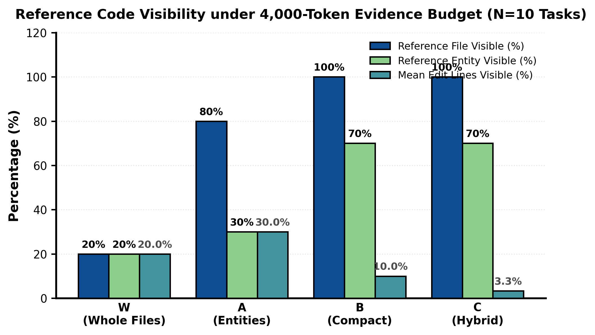

<div align="center">

# Reference-Code Visibility and Patch Applicability in Budgeted Code Repair

### A Gemma Pilot Study

**Madhusudhanan G · Independent Researcher**

[](LICENSE)
[](requirements.txt)
[](https://huggingface.co/datasets/princeton-nlp/SWE-bench_Lite)

**[Read the paper](paper_v2/main.pdf) · [Reproduction guide](docs/REPRODUCIBILITY.md) · [Experimental evidence](evidence/) · [Citation](#citation)**

</div>

---

This repository accompanies the manuscript **“Reference-Code Visibility and Patch Applicability in Budgeted Code Repair: A Gemma Pilot Study.”** It provides the research implementation, frozen experimental records, and analysis needed to trace the reported results back to source artifacts.

The study asks: **under a 4,000-token evidence budget, which reference-modified code remains visible to a repair model, and where do the observed repair attempts fail?** Using archived Gemma runs on SWE-bench Lite development tasks, it examines evidence visibility, patch application, and execution-based correctness.

> **Study status.** This is a pilot study with an interim fresh comparison: 22 of 40 planned fresh attempts completed. No issue resolution is demonstrated in either comparison cohort. The results characterize failure boundaries and do not establish a winning packaging policy.

## Start here

| To… | Open… |
| --- | --- |
| Read the manuscript | [Paper PDF](paper_v2/main.pdf) or [LaTeX source](paper_v2/main.tex) |
| Inspect the reported results | [Summary](paper_v2/data/summary.json), [attempt records](paper_v2/data/fresh_rows.csv), and [reference coverage](paper_v2/data/reference_coverage.csv) |
| Trace claims to experimental records | [Evidence ledger](paper_v2/evidence_ledger.csv) and [artifact provenance](docs/PROVENANCE.md) |
| Rebuild the analysis | [Quick start](#quick-start) and [detailed reproduction guide](docs/REPRODUCIBILITY.md) |
| Review verification and limitations | [Release validation](docs/VALIDATION.md) and [limitations](docs/REPRODUCIBILITY.md#limitations-and-interpretation) |

## Experimental design

Four deterministic policies package retrieved Python code under the same evidence-token ceiling:

| Policy | Representation | Packing rule |
| :---: | --- | --- |
| **W** | Whole files | Include complete files in retrieval order; skip files that exceed the remaining budget. |
| **A** | Complete entities | Include complete function and class bodies with source line ranges. |
| **B** | Compact excerpts | Include signatures, bounded docstrings, and 14-line opening excerpts. |
| **C** | Hybrid | Render the highest-ranked entity in full, with 9-line supporting excerpts for subsequent entities. |

The implementation uses AST-based entity extraction and BM25 retrieval. Developer reference patches enter only the offline evaluator diagnostic; they are excluded from the repair model's inputs and evidence selection.

| Setting | Specification |
| --- | --- |
| Model | `google/gemma-4-E4B-it` |
| Model revision | `4ecc2ba63bcac23ba4a767fc87025b1450f84c9c` |
| Benchmark | SWE-bench Lite, development split |
| Dataset revision | `6ec7bb89b9342f664a54a6e0a6ea6501d3437cc2` |
| Evidence ceiling | 4,000 tokens |
| Fresh output cap | 2,048 tokens |
| Fresh generation protocol | Greedy decoding, batch size 1, thinking disabled, 8-bit weights |

The [reproduction guide](docs/REPRODUCIBILITY.md) documents cohort boundaries and differences between historical inference and evaluation environments.

## Principal findings

### Evidence visibility

Across the 40 frozen fresh packets—10 tasks under each of four policies—the presence of a reference file often fails to translate into visibility of the actual edit site.

| Policy | Reference file visible | Reference entity visible | Edit site visible |
| :---: | ---: | ---: | ---: |
| **W** | 2 / 10 | 2 / 10 | 2 / 10 |
| **A** | 8 / 10 | 3 / 10 | 3 / 10 |
| **B** | 10 / 10 | 7 / 10 | 2 / 10 |
| **C** | 10 / 10 | 7 / 10 | 1 / 10 |

Whole-file packaging omits eight of ten reference files. Compact policies expose all reference files, but their excerpts miss the edit site in eight or nine tasks. Every policy misses the developer edit site in at least seven of ten tasks.



*Offline diagnostic computed from frozen evidence packets and evaluator-only reference patches. Source: [reference coverage records](paper_v2/data/reference_coverage.csv).*

### Patch application and correctness

| Cohort | Completed / planned | Applicable patches | Tested patches | Demonstrated resolutions |
| --- | ---: | --- | ---: | ---: |
| Development pilot | 12 / 12 | 7 recount-assisted | 7 | 0 |
| Fresh comparison, interim | 22 / 40 | 2 strict; 10 recount-assisted in total | 10 | 0 |

For the fresh comparison, strict application succeeds in **2/22 attempts (9.1%)**. Hunk recounting recovers eight additional patches, yielding **10/22 applicable patches (45.5%)** in total. Applicability alone does not establish behavioral correctness.

Five fresh tasks have complete four-policy generation sets. The remaining 18 planned attempts comprise 17 unstarted attempts and one reported interruption; their outcomes are unknown. Six of ten native evaluation tasks have fully verified controls under the manuscript's audit. See the [limitations and interpretation](docs/REPRODUCIBILITY.md#limitations-and-interpretation) before comparing policies or aggregating outcomes.

## Quick start

### Reproduce the analysis

**Requirements:** Python 3.10 or 3.11, `make`, and internet access to install dependencies and retrieve the pinned development dataset. The analysis requires no GPU, model weights, or API key.

```bash
git clone https://github.com/Madhumasa84/Gemma_paper_sm.git
cd Gemma_paper_sm

python3 -m venv .venv
source .venv/bin/activate
python -m pip install -r requirements.txt

make reproduce
```

The workflow verifies frozen input hashes, authenticates the pinned dataset download, and regenerates reference coverage, tables, result summaries, the evidence ledger, and all eight figure pairs. It then checks the paper's principal counts against the rebuilt outputs.

Generated analysis outputs are written to `paper_v2/`. The downloaded dataset is stored in `data/` and excluded from Git. For an offline run, supply the exact pinned dataset file as described in the [reproduction guide](docs/REPRODUCIBILITY.md#cpu-analysis-workflow).

### Verify the archived evidence

The verifier uses only Python's standard library and requires no download:

```bash
python3 scripts/verify_artifacts.py
```

It checks **247 retained evidence files** against their recorded byte sizes and SHA-256 digests, together with the principal result denominators and coverage totals.

### Build the paper

With TeX Live, `latexmk`, and the packages declared in `paper_v2/main.tex` installed:

```bash
make paper
```

The compiled manuscript is written to `paper_v2/main.pdf`. A PDF and generated figures/tables are included for direct reading. The [GitHub Actions workflow](.github/workflows/reproduce.yml) is configured to verify and reproduce the CPU analysis on pushes and pull requests.

## Repository structure

| Path | Contents |
| --- | --- |
| [`paper_v2/`](paper_v2/) | Submission manuscript, bibliography, analysis scripts, audited data, tables, and figures |
| [`gemma_paper/`](gemma_paper/) | Original retrieval, evidence packaging, prompting, and generation implementation |
| [`evidence/`](evidence/) | One canonical copy of fresh packets, checkpoints, outputs, predictions, native test logs, pilot records, and development provenance |
| [`scripts/`](scripts/) | Portable dataset retrieval and artifact verification |
| [`docs/`](docs/) | Reproduction instructions, provenance, validation, and third-party notices |

**The submission manuscript is `paper_v2/main.tex`.** Rebuilt outputs have one canonical location: tables in `paper_v2/tables/`, result records in `paper_v2/data/`, and the evidence ledger in `paper_v2/evidence_ledger.csv`.

## Reproducibility and provenance

The supported local workflow rebuilds the submitted analysis from recorded experiments. The original retrieval, packaging, model-loading, and repair modules remain in `gemma_paper/` for inspection. GPU inference requires the historical CUDA/model dependencies; it is not part of the CPU reproduction workflow and was not repeated during repository preparation.

The evidence directory contains a curated subset of the research archive. Retained source bytes are unchanged and recorded in one manifest, alongside their original paths. Redundant transfer archives, duplicate pilot exports, obsolete platform-specific scripts, and repeated generated files have been removed. The original 311-entry archive manifest remains as historical provenance; the verifier checks the 247 retained evidence files and every source digest in the current evidence ledger.

Some diagnostic table values are manually transcribed, including retrieval ranks and oracle-fit token estimates. The [reproduction guide](docs/REPRODUCIBILITY.md#cpu-analysis-workflow) identifies these values and distinguishes rendering them from independently recomputing them. Original prompt/configuration gaps and incomplete native controls remain documented.

For details, consult [provenance](docs/PROVENANCE.md), [release validation](docs/VALIDATION.md), and the [full reproduction guide](docs/REPRODUCIBILITY.md).

## Citation

If you use this code or evidence, please cite the accompanying manuscript. GitHub's **Cite this repository** feature reads the included [CITATION.cff](CITATION.cff). The following entry identifies the repository artifact:

```bibtex
@misc{madhusudhanan2026referencecode,
  author       = {{Madhusudhanan G}},
  title        = {Reference-Code Visibility and Patch Applicability in
                  Budgeted Code Repair: A Gemma Pilot Study},
  year         = {2026},
  howpublished = {Research code and experimental artifacts},
  url          = {https://github.com/Madhumasa84/Gemma_paper_sm}
}
```

## License

The author's original research code and repository documentation are released under the [MIT License](LICENSE). The manuscript, third-party source excerpts, benchmark content, reference patches, and archived model outputs retain their applicable terms; see [rights and third-party notices](docs/RIGHTS_AND_NOTICES.md).
